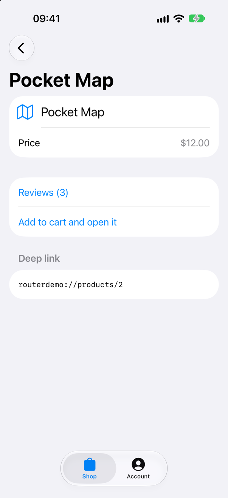
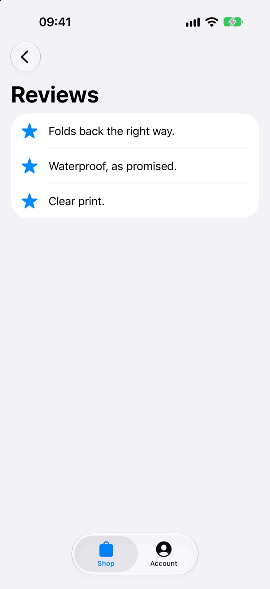
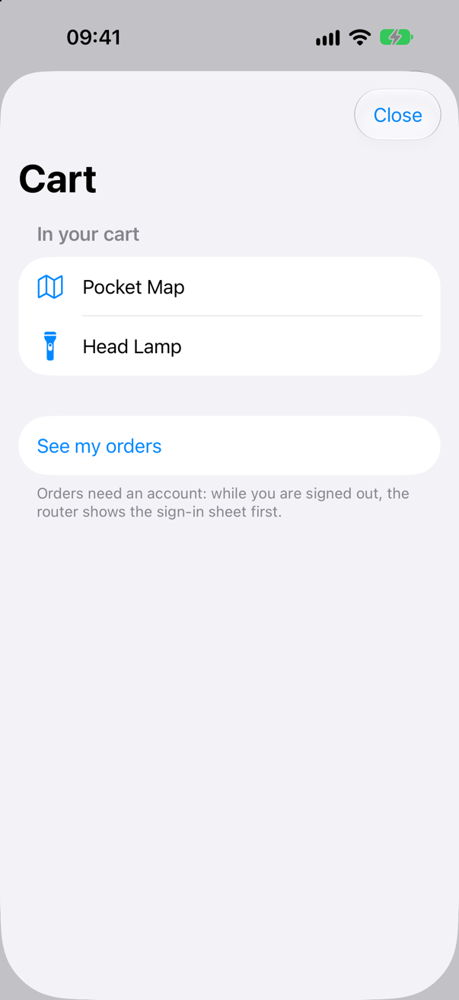
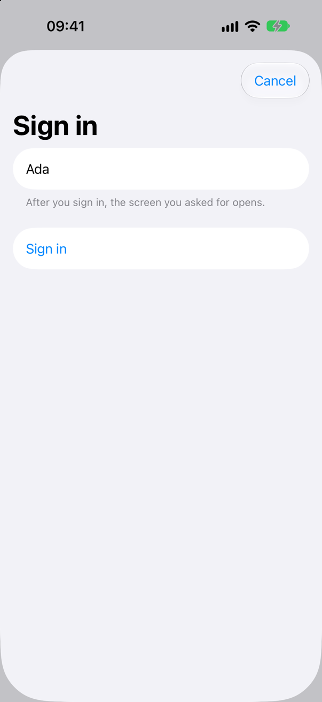

<!-- i18n-source: README.md@09ab6810d8d96e3ea94fe665de84ba5080b46572 status=reviewed -->
<!-- brand:start -->

<p align="center"><picture><source media="(prefers-color-scheme: dark)" srcset="https://raw.githubusercontent.com/muhittincamdali/SwiftRouter/main/.github/brand/banner-dark.svg"><source media="(prefers-color-scheme: light)" srcset="https://raw.githubusercontent.com/muhittincamdali/SwiftRouter/main/.github/brand/banner-light.svg"></picture></p>

<!-- lang-selector:start -->
<p align="center"><a href="README.md">English</a> · <a href="README.tr.md">Türkçe</a> · <a href="README.zh-CN.md">简体中文</a> · <a href="README.ja.md">日本語</a> · <a href="README.ko.md">한국어</a> · <a href="README.es.md">Español</a> · <a href="README.de.md">Deutsch</a> · <a href="README.fr.md">Français</a> · <a href="README.pt-BR.md">Português (Brasil)</a> · <a href="README.ru.md">Русский</a></p>
<!-- lang-selector:end -->

<p align="center">
<a href="https://github.com/muhittincamdali/SwiftRouter/actions/workflows/ci.yml"></a>
<a href="https://github.com/muhittincamdali/SwiftRouter/releases"><picture><source media="(prefers-color-scheme: dark)" srcset="https://raw.githubusercontent.com/muhittincamdali/SwiftRouter/main/.github/brand/badge-version-dark.svg"><source media="(prefers-color-scheme: light)" srcset="https://raw.githubusercontent.com/muhittincamdali/SwiftRouter/main/.github/brand/badge-version-light.svg"></picture></a>
<a href="https://github.com/muhittincamdali/SwiftRouter/blob/main/Package.swift"><picture><source media="(prefers-color-scheme: dark)" srcset="https://raw.githubusercontent.com/muhittincamdali/SwiftRouter/main/.github/brand/badge-platforms-dark.svg"><source media="(prefers-color-scheme: light)" srcset="https://raw.githubusercontent.com/muhittincamdali/SwiftRouter/main/.github/brand/badge-platforms-light.svg"></picture></a>
<a href="https://github.com/muhittincamdali/SwiftRouter/blob/main/Package.swift"><picture><source media="(prefers-color-scheme: dark)" srcset="https://raw.githubusercontent.com/muhittincamdali/SwiftRouter/main/.github/brand/badge-language-dark.svg"><source media="(prefers-color-scheme: light)" srcset="https://raw.githubusercontent.com/muhittincamdali/SwiftRouter/main/.github/brand/badge-language-light.svg"></picture></a>
<a href="https://github.com/muhittincamdali/SwiftRouter/blob/main/LICENSE"><picture><source media="(prefers-color-scheme: dark)" srcset="https://raw.githubusercontent.com/muhittincamdali/SwiftRouter/main/.github/brand/badge-license-dark.svg"><source media="(prefers-color-scheme: light)" srcset="https://raw.githubusercontent.com/muhittincamdali/SwiftRouter/main/.github/brand/badge-license-light.svg"></picture></a>
</p>

<p align="center">
<a href="#schnellstart"><picture><source media="(prefers-color-scheme: dark)" srcset="https://raw.githubusercontent.com/muhittincamdali/SwiftRouter/main/.github/brand/button-start-de-dark.svg"><source media="(prefers-color-scheme: light)" srcset="https://raw.githubusercontent.com/muhittincamdali/SwiftRouter/main/.github/brand/button-start-de-light.svg"></picture></a>
<a href="https://muhittincamdali.github.io/SwiftRouter/documentation/swiftrouter/"><picture><source media="(prefers-color-scheme: dark)" srcset="https://raw.githubusercontent.com/muhittincamdali/SwiftRouter/main/.github/brand/button-docs-de-dark.svg"><source media="(prefers-color-scheme: light)" srcset="https://raw.githubusercontent.com/muhittincamdali/SwiftRouter/main/.github/brand/button-docs-de-light.svg"></picture></a>
<a href="https://github.com/muhittincamdali/SwiftRouter/tree/main/Examples"><picture><source media="(prefers-color-scheme: dark)" srcset="https://raw.githubusercontent.com/muhittincamdali/SwiftRouter/main/.github/brand/button-examples-de-dark.svg"><source media="(prefers-color-scheme: light)" srcset="https://raw.githubusercontent.com/muhittincamdali/SwiftRouter/main/.github/brand/button-examples-de-light.svg"></picture></a>
</p>

> Dies ist eine Übersetzung der englischen README. Bei Abweichungen gilt die englische Fassung.

<!-- brand:end -->

SwiftRouter ist ein Swift-Paket für die Navigation in SwiftUI-Apps auf iOS 17+, macOS 14+,
tvOS 17+, watchOS 10+ und visionOS 1+. Du listest deine Screens in einem Enum auf, und ein
einziger `Router` hält den gesamten Navigationszustand: die gepushten Screens, die Sheets und
Full-Screen-Covers darüber sowie die Screens, die innerhalb dieser Sheets gepusht werden. Deep
Links werden auf diesen Zustand abgebildet, Guards prüfen jeden Screen, bevor er erscheint, und
jeder Tab kann seinen eigenen Stack behalten. Das Paket hat keine Abhängigkeiten.

<table>
<tr>
<td align="center"><picture><source media="(prefers-color-scheme: dark)" srcset="docs/images/product-dark.png"></picture><br><sub><code>routerdemo://products/2</code></sub></td>
<td align="center"><picture><source media="(prefers-color-scheme: dark)" srcset="docs/images/reviews-dark.png"></picture><br><sub><code>…/products/2/reviews</code></sub></td>
<td align="center"><picture><source media="(prefers-color-scheme: dark)" srcset="docs/images/cart-dark.png"></picture><br><sub><code>routerdemo://cart</code></sub></td>
<td align="center"><picture><source media="(prefers-color-scheme: dark)" srcset="docs/images/sign-in-dark.png"></picture><br><sub><code>…/account/orders/1001</code></sub></td>
</tr>
</table>

Die Screenshots stammen aus der [Beispiel-App](Examples/RouterDemo) auf einem iPhone-Simulator:
Jeder zeigt den Zustand, den der Router über den darunter stehenden Link erreicht hat
([`scripts/capture-screens.sh`](scripts/capture-screens.sh)).

## Highlights

- **Typisierte Routen** — Screens sind Enum-Cases mit assoziierten Werten, daher lässt sich ein
  nicht vorhandenes Ziel nicht kompilieren.
- **Ein Zustand für Stacks und Sheets** — `router.entries` listet jeden gepushten Screen, jedes
  Sheet und jedes Full-Screen-Cover auf. Ein Sheet hat seinen eigenen Navigationsstack und kann
  ein weiteres Sheet präsentieren. Der Zurück-Button, die Zurück-Wischgeste und das Herunterwischen
  eines Sheets werden in den Router zurückgeschrieben.
- **Deep Links auf ganze Zustände** — `shop://products/42` und
  `https://shop.example.com/products/42` können den Katalog mit dem Produkt obenauf öffnen oder
  ein Sheet. Muster wie `/products/:id` werden vom spezifischsten an abgeglichen, und Pfade zum
  Teilen werden aus denselben Mustern gebaut.
- **Links werden geprüft, bevor sie verwendet werden** — Grenzen für Länge, Segmente und
  Query-Parameter, `https` nur auf den Hosts, die du angibst, keine `..`-Segmente, keine
  Steuerzeichen, und typisierte Werte, die `nil` sind, statt abzustürzen (`Int`-Überlauf, `nan`,
  `inf`).
- **Guards, die kein Pfad umgeht** — ein Guard sieht jeden Screen, der per Push, Sheet, Deep Link,
  wiederhergestelltem Snapshot oder `NavigationLink` hinzugefügt wird. Eine Weiterleitung zur
  Anmeldung behält die Anfrage, und `resumePending()` öffnet sie nach der Anmeldung.
- **Tabs und Zustandswiederherstellung** — `TabRouter` hält pro Tab einen Stack und geht zurück zur
  Wurzel, wenn der gewählte Tab erneut ausgewählt wird; `routerStateRestoration(_:key:)` sichert
  den Zustand pro Scene und schickt ihn bei der Rückkehr durch die Guards.
- **Getestet** — 86 Swift-Testing-Tests auf macOS und einem iPhone-Simulator sowie 7 UI-Tests, die
  die Beispiel-App auf einem iOS-27-Simulator bedienen: Push und Zurück, ein Deep Link drei Screens
  tief, das Anmelde-Sheet über dem Warenkorb-Sheet und das Fortsetzen der Anfrage nach der
  Anmeldung.

## Schnellstart

**1. Paket hinzufügen**

Wähle in Xcode **File › Add Package Dependencies…** und füge die Repository-URL in das Suchfeld
oben rechts ein:

```text
https://github.com/muhittincamdali/SwiftRouter.git
```

Lass **Dependency Rule** auf **Up to Next Major Version** ab `2.0.0` stehen und klicke auf
**Add Package**. Wähle im nächsten Fenster neben **SwiftRouter** dein App-Target und klicke erneut
auf **Add Package**.

**2. Modul importieren**

```swift
import SwiftRouter
```

Setze diese Zeile an den Anfang jeder Swift-Datei, die den Router verwendet, neben
`import SwiftUI`.

**3. Verwenden**

Ersetze in einer neuen Xcode-App (**File › New › Project… › App**) den gesamten Inhalt von
`ContentView.swift` durch:

```swift
import SwiftRouter
import SwiftUI

enum Screen: Route {
    case detail(Int)
    case about

    @ViewBuilder
    func view() -> some View {
        switch self {
        case .detail(let number):
            Text("Item \(number)")
                .navigationTitle("Detail")
        case .about:
            Text("SwiftRouter quick start")
                .navigationTitle("About")
        }
    }
}

struct ContentView: View {
    @State private var router = Router<Screen>()

    var body: some View {
        RouterView(router: router) {
            List {
                RouterLink("Open item 1", to: Screen.detail(1))
                RouterLink("About", to: Screen.about, style: .sheet)
                Button("Open items 2 and 3") {
                    router.push(contentsOf: [.detail(2), .detail(3)])
                }
            }
            .navigationTitle("Home")
        }
    }
}
```

Drücke **Run** (⌘R). **Open item 1** pusht einen Screen, **About** öffnet ein Sheet (wische es
nach unten, um es zu schließen), und **Open items 2 and 3** pusht zwei Screens auf einmal; der
Zurück-Button geht jeweils einen Screen zurück.

## Installation

### Swift Package Manager

Mit `https://github.com/muhittincamdali/SwiftRouter.git`, der Repository-URL, fügst du das Paket
in Xcode über **File › Add Package Dependencies…** hinzu oder trägst es in die `dependencies`
deiner `Package.swift` ein:

```swift
dependencies: [
    .package(url: "https://github.com/muhittincamdali/SwiftRouter.git", from: "2.0.0")
],
targets: [
    .target(name: "YourApp", dependencies: [
        .product(name: "SwiftRouter", package: "SwiftRouter")
    ])
]
```

### Voraussetzungen

|             | Minimum                                           |
| ----------- | ------------------------------------------------- |
| Swift       | 6.2 (Xcode 26 oder neuer)                         |
| Plattformen | iOS 17, macOS 14, tvOS 17, watchOS 10, visionOS 1 |

Version 2.0.0 ersetzt die API von 1.0.0 (Februar 2026), die Routen zur Laufzeit über Strings
nachschlug. Im Juni 2026 wurden die Quellen von 1.0.0 durch Platzhalter-Code ersetzt; 2.0.0 ist
ein neuer Router, der für den Swift-6-Sprachmodus gebaut und getestet wurde und die Präsentations-,
Tab- und Zustandssicherungsfunktionen von SwiftUI-Navigation-Pro übernimmt.
[CHANGELOG.md](CHANGELOG.md) listet die Änderungen auf, und
[Migrating from version 1](https://muhittincamdali.github.io/SwiftRouter/documentation/swiftrouter/migratingfromversion1)
ordnet die alte API der neuen zu.

## Verwendung

Die folgenden Beispiele sind aus
[`Examples/RouterDemo/RouterDemo/ReadmeSamples.swift`](Examples/RouterDemo/RouterDemo/ReadmeSamples.swift)
kopiert. Die Beispiel-App und die Test-Suite kompilieren beide diese Datei, und die Tests führen
die Deep-Link- und Anmelde-Beispiele aus.

### Navigieren

Screens innerhalb einer `RouterView`, Sheets eingeschlossen, lesen den Router aus dem
Environment:

```swift
@Environment(Router<AppRoute>.self) private var router
```

| Aufruf                          | Was er tut                                                                           |
| ------------------------------- | ------------------------------------------------------------------------------------ |
| `push(_:)`, `push(contentsOf:)` | Pusht einen oder mehrere Screens auf den obersten Stack                              |
| `present(_:style:)`             | Zeigt ein `.sheet` oder `.fullScreenCover` mit eigenem Stack                         |
| `pop(_:)`, `popToRoot()`        | Entfernt gepushte Screens des obersten Stacks; schließt nie ein Sheet                |
| `popTo(_:)`                     | Geht bis zum letzten Vorkommen einer Route zurück, über Sheets hinweg                |
| `dismiss()`, `dismissAll()`     | Schließt das oberste Sheet oder alle Sheets                                          |
| `reset()`                       | Schließt alles und geht zurück zur Root-View                                         |
| `setEntries(_:)`                | Ersetzt den gesamten Zustand, zum Beispiel `[.push(.product(id: 3)), .sheet(.cart)]` |

Jeder Aufruf, der Screens hinzufügt, gibt `.applied`, `.redirected` (ein Guard hat etwas anderes
angezeigt), `.cancelled` (ein Guard hat abgelehnt) oder `.rejected` (mehr als `maxDepth`
Einträge, standardmäßig 64) zurück.

### Deep Links

```swift
enum ShopRoute: Route, Codable {
    case catalog
    case product(id: Int)
    case cart
    case orders
    case signIn

    var needsAccount: Bool { self == .orders }

    func view() -> some View {
        Text(String(describing: self))
    }
}

func makeShopLinks() -> DeepLinks<ShopRoute> {
    var links = DeepLinks<ShopRoute>(schemes: ["shop"], hosts: ["shop.example.com"])
    links.add("/products/:id") { match in
        guard let id = match.int("id") else { return nil }
        return [.catalog, .product(id: id)]
    }
    links.add("/cart", entries: { _ in [.sheet(.cart)] })
    links.add("/orders") { _ in [.orders] }
    return links
}

struct ShopView: View {
    @State private var router = Router<ShopRoute>()
    private let links = makeShopLinks()

    var body: some View {
        RouterView(router: router) {
            Text("Home")
        }
        .onDeepLink(links, router: router)
    }
}
```

`shop://products/42` und `https://shop.example.com/products/42` öffnen beide den Katalog mit
Produkt 42 obenauf, sodass der Zurück-Button zum Katalog führt. In einer URL mit eigenem Schema
wird der Host als erstes Pfadsegment gelesen. `onDeepLink` empfängt eigene Schemas über
`onOpenURL` und Universal Links über `onContinueUserActivity`. Registriere das Schema in deinem
Target unter **URL Types**; Universal Links brauchen zusätzlich das Associated-Domains-Entitlement.

Ein Handler gibt `nil` zurück, wenn ein Wert nicht akzeptabel ist, und das nächste passende Muster
wird versucht. Ein Link, der zu keinem Muster passt oder abgelehnt wird, lässt den
Navigationszustand unverändert.

### Guards

```swift
@MainActor
@Observable
final class AccountSession {
    var isSignedIn = false
}

@MainActor
func protectOrders(_ router: Router<ShopRoute>, session: AccountSession) {
    router.addGuard(.requiring(
        { session.isSignedIn },
        for: { $0.needsAccount },
        otherwise: [.sheet(.signIn)]
    ))
}

@MainActor
func signIn(_ router: Router<ShopRoute>, session: AccountSession) {
    session.isSignedIn = true
    if router.resumePending() == nil {
        router.dismiss()
    }
}
```

Solange du abgemeldet bist, zeigt `shop://orders` das Anmelde-Sheet und behält die Anfrage.
`signIn` ersetzt dann das Sheet durch den Bestellungen-Screen. Rufe nach dem Abmelden
`router.revalidate()` auf, um die Screens zu entfernen, die nicht mehr erlaubt sind.

### Tabs und Zustandswiederherstellung

```swift
enum AppTab: String, Hashable, CaseIterable {
    case shop, orders
}

struct TabsView: View {
    @State private var tabs = TabRouter<AppTab, ShopRoute>(tabs: AppTab.allCases)

    var body: some View {
        TabView(selection: tabs.selectionBinding) {
            RouterView(router: tabs.router(for: .shop)) {
                Text("Catalog")
            }
            .routerStateRestoration(tabs.router(for: .shop), key: "shop")
            .tabItem { Label("Shop", systemImage: "bag") }
            .tag(AppTab.shop)

            RouterView(router: tabs.router(for: .orders)) {
                Text("Orders")
            }
            .routerStateRestoration(tabs.router(for: .orders), key: "orders")
            .tabItem { Label("Orders", systemImage: "shippingbox") }
            .tag(AppTab.orders)
        }
    }
}
```

Jeder Tab behält seinen eigenen Stack, und erneutes Auswählen des gewählten Tabs geht zurück zur
Wurzel. `tabs.open(url, using: [.shop: shopLinks, .orders: orderLinks])` öffnet einen Link im
ersten Tab, dessen Links dazu passen. Der Zustand wird im Speicher der Scene gesichert, sodass
jedes Fenster seinen eigenen behält, und er kommt zurück, nachdem das System die App im
Hintergrund beendet hat. Dafür müssen die Routen `Codable` sein.

## So werden Links geprüft

Eine URL kommt von außerhalb der App, daher prüft `DeepLinks` sie, bevor ein Muster läuft:

| Eingabe                                                                             | Ergebnis                                             |
| ----------------------------------------------------------------------------------- | ---------------------------------------------------- |
| Länger als 2048 Bytes, mehr als 32 Segmente oder mehr als 32 Query-Einträge         | Abgelehnt; die Länge wird zuerst geprüft             |
| `http`, ein unbekanntes Schema, `https` auf einem Host, den du nicht angegeben hast | Abgelehnt; `*.example.com` akzeptiert nur Subdomains |
| Ein Benutzername oder Passwort in der URL                                           | Abgelehnt                                            |
| Ein `.`- oder `..`-Segment, auch als `%2e` geschrieben                              | Abgelehnt, nicht aufgelöst                           |
| `%2F`                                                                               | Bleibt innerhalb eines Segments                      |
| Steuerzeichen, bidirektionale Formatierungszeichen, Bytes, die kein UTF-8 sind      | Abgelehnt                                            |
| `nan`, `inf`, `4.5` oder `99999999999999999999`, mit `int` oder `double` gelesen    | `nil`                                                |

Die Grenzen werden mit `DeepLinkLimits` festgelegt. Das Paket gibt URLs oder Routen nie aus und
protokolliert sie nie; Links können Anmelde- oder Zurücksetzen-Tokens enthalten. Der Artikel
[Deep linking](https://muhittincamdali.github.io/SwiftRouter/documentation/swiftrouter/deeplinking)
listet jede Regel auf.

## Beispiel-App

[`Examples/RouterDemo`](Examples/RouterDemo) ist ein kleiner Shop für iOS und macOS: ein Shop- und
ein Account-Tab, Produkte mit Bewertungen, ein Warenkorb-Sheet, Bestellungen hinter einem
Anmelde-Guard, Deep Links auf dem Schema `routerdemo://` und gesicherter Zustand. Öffne
`Examples/RouterDemo/RouterDemo.xcodeproj`, wähle das Scheme **RouterDemo** und einen
iPhone-Simulator oder **My Mac** und drücke **Run** (⌘R). So probierst du einen Link im Simulator
aus:

```sh
xcrun simctl openurl booted "routerdemo://products/2/reviews"
```

Das Target **RouterDemoUITests** (⌘U auf einem iPhone-Simulator) prüft die Abläufe auf dem
Bildschirm.

## Dokumentation

Die [Dokumentation](https://muhittincamdali.github.io/SwiftRouter/documentation/swiftrouter/)
behandelt jeden öffentlichen Typ, mit diesen Artikeln:

- [Getting started](https://muhittincamdali.github.io/SwiftRouter/documentation/swiftrouter/gettingstarted)
- [Deep linking](https://muhittincamdali.github.io/SwiftRouter/documentation/swiftrouter/deeplinking)
- [Guarding screens](https://muhittincamdali.github.io/SwiftRouter/documentation/swiftrouter/guardingscreens)
- [Tabs and state restoration](https://muhittincamdali.github.io/SwiftRouter/documentation/swiftrouter/tabsandstaterestoration)
- [Migrating from version 1](https://muhittincamdali.github.io/SwiftRouter/documentation/swiftrouter/migratingfromversion1)

## Mitwirken

Fehlerberichte und Pull Requests sind willkommen; [CONTRIBUTING.md](CONTRIBUTING.md) erklärt, wie
du die Tests und die Beispiel-App ausführst. Sicherheitsprobleme meldest du vertraulich, wie in
[SECURITY.md](SECURITY.md) beschrieben.

## Lizenz

SwiftRouter ist unter der MIT-Lizenz veröffentlicht. Siehe [LICENSE](LICENSE).
